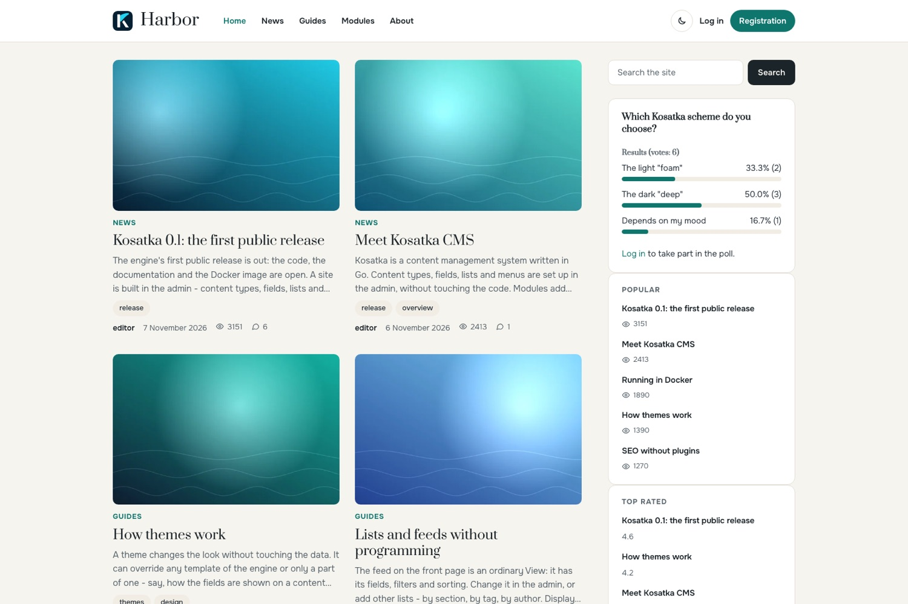

# Harbor

A theme for [Kosatka](https://github.com/kosatka-cms/kosatka): a
classic blog of cards and a sidebar. A white header bar with the name,
the slogan and the menu; the lists as cards in two columns, the pinned
item leading as a wide card with its picture beside the text; the
sidebar's blocks as cards; a dark footer with the footer's blocks in
columns. An accent colour, a light and a dark scheme.



## Install

Kosatka 0.1.4 or newer.

```bash
app theme add https://github.com/kosatka-cms/kosatka-theme-harbor
```

Then commit `themes/` and choose *Harbor* on *Appearance*. See
[Distributing a theme](https://kosatka-cms.github.io/kosatka/themes/distribute/).

## Settings

On *Appearance → Harbor → Settings*:

| Setting | Default |
|---|---|
| Accent colour - teal, coral, navy or plum | teal |
| Colour scheme by default - as on the visitor's device, light or dark | as on the device |
| The contents of a text with three headings or more, at the top of the sidebar | on |
| Sharing and the author under a text whose type shows the author and date | on |
| Logging in and registration in the header | on |

A visitor switches the scheme with the button in the header; the choice
is kept in the browser.

## Lists

A list in the content is a grid of cards: the picture, a term shown as a
badge (in the accent), the title, the start of the text, the tags as
chips, then the author, the date and the counters. An item *sticky at
the top of lists* leads across both columns, its picture beside the
text. In the sidebar a list is lines with a small picture.

## An article

When the content type shows the author and date (an article, not a page
like *About*), a meta row under the title carries the avatar, the name,
the dates, the views, the reading time and the comments (a link to
them); the contents of a long text open the sidebar;
under the text come sharing (the browser's own share sheet where it has
one, copying the address, an e-mail) and the author's card with the
signature from the profile.

## Regions

The engine's regions, so blocks placed for another theme stay where they
are. The header region holds the main menu; the *Footer*'s blocks stand
side by side in the dark footer. A new site gets the copyright block
and a "Powered by Kosatka CMS" block in *Footer bottom line*; both are
ordinary blocks to change or remove on *Blocks*.

## Fonts

Prata for headings, Onest for the text, both with Latin and Cyrillic.
They come with the theme (`static/fonts`, SIL Open Font License 1.1)
and the site serves them: no requests to other servers.

## Translations

The theme's own strings: English, Russian, German and Spanish
(`translations/`).

## License

MIT
